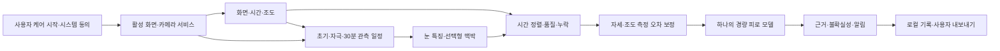

# NeuroLens2 EyeCare 자연 관측 피로 엔진 설계

버전 0.2 설계안 · 2026-10-10 · 현재 앱 0.2.1-alpha · 알고리즘 미구현/미검증

**최신 요구 반영:** 매번 보정·표준 화면·PRE/POST 검사를 수행하던 v0.1 설계를 폐기한다. 자연스럽게 폰을 쓰는 동안 기회가 생기는 신호를 모으고 자세·조도·누락을 보정하는 하나의 경량 피로 모델을 개발한다. 이전 내용은 보관본이며 현재 구현 기준이 아니다.

[현재 PRD](EyeCare_PASSIVE_PRD_2026-10-10.md) · [벤치마크](docs/eye-fatigue/BENCHMARK_PROTOCOL.md) · [구현 계획](docs/eye-fatigue/IMPLEMENTATION_PLAN.md) · [자산/연구 감사](docs/eye-fatigue/REFERENCE_AUDIT.md) · [수치 계약](docs/eye-fatigue/passive-spec-v0.2.json)

## 1. 문제 정의

관측값은 피로, 과제 집중, 눈 모양, 시선 방향, 머리 자세, 카메라 위치, 주변 빛, 화면 조명, 기기 처리의 영향을 동시에 받는다. 설계 목표는 모든 각도에서 모든 신호를 정확히 복원하는 것이 아니다. 여러 조건에서 유효한 일부 신호를 확보하고, 조건 변화가 피로 변화처럼 보이는 오류를 줄여 자동 케어에 사용할 수 있는 범위를 넓힌다.

깜빡임 감소와 오래 감김은 피로의 확정 정답이 아니다. 독서 중 깜빡임 변화와 졸림을 구별해야 한다. 맥박은 전신 반응의 보조 특징이며 눈 피로 직접 측정이 아니다. [깜빡임의 과제 효과 연구](https://pubmed.ncbi.nlm.nih.gov/36763349/), [관련 연구 감사](docs/eye-fatigue/REFERENCE_AUDIT.md)

연구 목표는 현재 눈 피로 NRS 0~10과 30분 전후 변화량이다. 정상 사용에는 NRS 응답을 요구하지 않는다. score 0~100은 검증된 예측의 표현 척도다. 기존 불편감 0~4와 서로 다른 라벨로 보존한다.

## 2. 시스템 경로

사용자 시작 → 권한/전경 서비스 → 화면·문맥 저속 관측 → 자동 관측 스케줄러 → 눈/피부 수치 추출 → 품질·시간 정렬 → 조건/개인차 보정 → 단일 피로 모델 → 결과 상태/알림 → 로컬 기록/내보내기.

| 모듈 후보 | 책임 | 기존 코드와 관계 |
|---|---|---|
| CareSessionCoordinator | 승인 상태, 서비스 수명, 종료/부분 결과, 재개 필요 | ProjectionService와 Repository를 감싸는 상위 조정 |
| ScreenContextCollector | 기존 화면 변화, 조도, 화면 켜짐, 선택적 앱 범주 | ExposureEngine 유지; UsageReader를 세션 문맥으로 확장 |
| PassiveCaptureScheduler | 초기/중간/30분 관측, 트리거 병합, 자원 예산 | 새 모듈. 카메라 FGS 재생성으로 자동화를 구현하지 않음 |
| EyeObservationSource | CameraX/필요 시 Camera2, YUV, 랜드마크, 실제 시각 | 새 camera 전경 서비스; 앱 화면 lifecycle에 종속시키지 않음 |
| EyeEventExtractor | 눈 개방도·이벤트·방향 변화·거리 후보 | 고정 뉴로렌즈 수학을 포팅하고 품질/감김 로직 수정 |
| PulseFeatureExtractor | 원래 RGB ROI·POS/CHROM·합의·화면 조명 혼입 | 선택형 보조, 안정 창에서만 실행 |
| ObservationQuality / ContextNormalizer | 모달리티별 시간·누락·측정 편향 보정 | 눈 닫힘과 품질을 분리; 보정 버전 고정 |
| PassiveFatigueModel | 하나의 학습 모델, 누락 마스크·예측/불확실성 | 기존 시선 모델과 피로 모델을 구별 |
| CareAlertPolicy / PassiveReportAssembler | 근거별 결과·알림 제한·schema 3 | SQLite/ReportExporter/collector 확장 |

처리와 모델은 기기 안에서 실행한다. UI 렌더링과 센서 작업 큐를 분리하고 유한한 프레임 풀을 사용한다. CameraX의 최신 프레임 처리에서 드롭이 발생하면 실제 표본 간격을 기록한다. 카메라 센서 시각은 기기 시간 소스를 확인한 뒤 단조 시각과 정렬한다. [CameraX 분석](https://developer.android.com/media/camera/camerax/analyze), [센서 시각 기준](https://developer.android.com/reference/android/hardware/camera2/CameraCharacteristics#SENSOR_INFO_TIMESTAMP_SOURCE)

## 3. 상태와 수명

케어 설정의 enabled와 센서의 active를 별도 상태로 둔다.

| 상태 | 입력/전이 | 처리 |
|---|---|---|
| OFF | 사용자 끄기 | 자원 없음 |
| READY | 설정은 켜졌지만 승인된 관측 없음 | 시작/재개 진입점, 시간 기록 가능 범위 표시 |
| STARTING | 보이는 앱에서 사용자 시작 | 동의 및 FGS 시작, 최초 카메라 관측 |
| WATCHING | 화면 공유 유효 | 화면/문맥 관측; 무거운 분석은 일정/트리거에 따라 |
| OBSERVING_EYES | 적법한 camera FGS와 자원 유효 | 45~60초 구간, 품질별 일부 특징 생성 |
| DEGRADED | 카메라 경쟁·조도 불명·열 상승 | 가능한 입력만 처리, 원인/누락 표시 |
| ENDED / NEEDS_RESTART | 잠금·공유 중지·죽음·권한 철회 | flush, 자원 해제, 재개 필요 |

영상 변화 트리거는 WATCHING 안에서 동작한다. 캡처 권한이 없는 READY에서 화면의 시각 변화 감지를 약속하지 않는다. 프로세스 죽음 뒤 옛 Projection token을 재사용하지 않는다. foreground camera 시작·간헐 자원 재획득·경쟁 복귀는 P0 기기 시험으로 허용 범위를 결정한다. [플랫폼 근거](https://developer.android.com/develop/background-work/services/fgs/service-types#camera)

시스템/사용자 중지 뒤 허가 없는 자동 케어 복원을 하지 않는다. 카메라만 종료되면 화면 기반 케어는 살아 있을 수 있다. 화면 공유만 종료되면 기본 세션은 끝낸다. 별도 허용되는 카메라 지속 기능은 이번 기본 동작에 포함하지 않는다.

## 4. 수집과 시간 계약

- 화면: 기존 최대 2fps·긴 변 256, dt≤1.5초의 유효 표본 쌍과 제외 시간 규칙 유지.
- 카메라: 약 640×480의 지원 분석 해상도부터 시작. 30fps 공급/15fps 랜드마크 후보를 30fps 추론과 비교. 기기 요청 FPS와 실제 이벤트 FPS를 구별.
- 눈 이벤트: 프레임이 아니라 실제 timestamp로 지속시간 계산. 누락 경계를 가로지르는 깜빡임은 불확정으로 기록.
- 피부: 이마·좌우 볼 ROI의 원래 RGB 수치만 보존. 랜드마크용 밝기 보정 영상은 pulse에 넣지 않음.
- 환경: lux on-change를 저빈도로 요약, 센서 없음/가림/낡은 표본의 provenance와 age 기록.
- 문맥: 폰 회전·움직임, 앱 범주·확신도, 화면 밝기 설정. 콘텐츠의 의미·텍스트 수집 제외.

10초 화면 창과 60초 수치 창을 단조 시각 기준으로 결합한다. 교집합 유효 시간과 시각 정렬 오차를 기록한다. 60초 창이 겹쳐도 독립 근거 2개로 세지 않는다. 온라인 모델은 해당 시점까지의 자료만 사용한다.

시간 필드는 continuousUseMs, screenObservedMs, screenExcludedMs, cameraOpenMs, eyeValidMs, pulseValidMs, unknownUseMs로 구별한다. 카메라 닫힌 시간은 눈 관측 실패와 별도로 scheduled-off로 기록한다. 사용시간에 포함된 정적 화면을 ‘미재생’으로 확정하지 않는다.

콘텐츠 변화 평균은 Σ(변화 특징×유효 dt)/Σ유효 dt로 계산한다. 실제 사용자 눈이 받은 광량·빠른 점멸의 주파수를 역산하지 않는다. 디지털 화면 밝기는 광학 조도와 다른 변수다.

## 5. 눈 특징 — 보정 과제 없는 추출

### 개방도와 이벤트

눈 폭으로 정규화한 상하 눈꺼풀 간격을 좌우 별도로 계산한다. 품질은 얼굴/눈 위치의 신뢰, 가림, 선명도, ROI 해상도, 시간 연속성으로 평가한다. **눈이 닫혔다는 이유로 품질을 낮추지 않는다.** 기존 NeuroLens faceFeatures의 open 의존 q는 그대로 이전하지 않는다.

열림 기준은 자연 관측의 높은 개방도 분위수와 모집단 눈 모양 prior를 함께 사용한다. 충분한 자연 표본이 쌓이기 전에는 불확실성이 높다. 초기에 감고 있던 눈을 정상 개방 기준으로 확정하지 않는다. 각 30분 비교에서는 개방도 기준을 고정하고 초기/종료에 같은 정규화를 적용한다.

출력 후보:

- 분당 깜빡임, 깜빡임 간격 중앙값/긴 간격 비율, 지속시간 분포.
- 자연 기준 대비 상대 개방도·변동, 오래 감김 비율, 좌우 비대칭.
- 불완전 깜빡임은 검증된 해상도/조건에서만 출력; 낮은 FPS·가림에서는 unavailable.
- 이벤트의 시작/최대 감김/끝이 관측되지 않으면 확정 이벤트로 세지 않음.

오래 감김과 PERCLOS 유사 특징은 졸림 혼동을 연구 라벨로 평가한다. 실제 동공의 80% 가림을 증명하지 않은 상대 개방도 비율에 임의의 임상 이름/경계값을 붙이지 않는다.

### 시선 관련 특징

기존 eyeUV의 홍채 상대 위치·머리 yaw/pitch·얼굴 중심을 이용한다. 머리 움직임과 눈 안의 홍채 움직임을 분리하고, 회전/크기 변화가 작은 구간에서 방향 변화율·변동·안정 구간 비율을 계산한다.

사용자 보정 없이 정확한 화면의 응시점, 미세 단속운동, 특정 기사/버튼 응시 시간을 주장하지 않는다. ‘한 지점 오래 응시’는 초기에는 **눈·머리 방향 변화가 적은 관측 구간**이라는 proxy다. 영상 좌표의 매끄러운 커서/경계 제한을 원시 측정에 사용하지 않는다. 특정 기기에서 일반화된 외관 기반 시선 모델이 추가 효용을 보이면 경량 후보로 비교한다. [MediaPipe가 제공하는 출력](https://ai.google.dev/edge/mediapipe/solutions/vision/face_landmarker/android)

### 거리와 자세

홍채 크기와 카메라 내재 파라미터가 신뢰될 때 거리 범주를 연구한다. 없는 기기에서는 같은 사용자의 얼굴 크기/자세가 비슷한 구간의 상대 변화만 후보로 쓴다. 얼굴 크기 하나만으로 정확한 cm를 출력하지 않는다.

거리 특징은 ‘가까이 보는 습관’이다. 안경 도수·시력 0.8/1.0·시력 저하를 추정하는 기능은 만들지 않는다. 각도 보정이 불안정하거나 눈이 가려지면 거리만 제외한다. [홍채 거리 추정의 원리와 적용 범위](https://research.google/blog/mediapipe-iris-real-time-iris-tracking-depth-estimation/)

## 6. rPPG는 기여가 확인되는 조건만

첫 후보는 원래 RGB 피부 ROI의 POS/CHROM과 ROI/주파수/시간 합의다. 가벼운 전처리와 기존 NeuroLens 신호 수학을 먼저 사용한다. 대형 영상 기반 rPPG 네트워크는 첫 앱의 기본 의존성으로 넣지 않는다.

연속 30~60초 안정 구간에서 HR 후보·품질·변화량을 만든다. 화면 밝기 시계열과 피부 신호의 공통 변화, 카메라 노출 급변, 움직임을 기록한다. 화면 조명과 맥박 후보의 동조는 오염 의심 지표이지 완벽한 제거 방법이 아니다. 안정 신호를 얻으려고 중립 화면을 띄우거나 얼굴 각도를 맞추라고 요구하지 않는다.

참조 기준 센서와 일치하지 않는 pulse 후보는 모델 입력에서 제외한다. 어두운 환경의 HR 출력률을 높이려고 보간으로 파형을 만들지 않는다. HR이 맞아도 박동 간격/HRV가 맞는 것은 아니다. 짧은 자연 관측에서는 HRV/스트레스 점수 비활성, HR 특징도 독립적인 모델 효용 검증 뒤 채택한다. [rPPG-Toolbox](https://github.com/ubicomplab/rPPG-Toolbox)

기존 세션 추세 repair나 미래 이웃 창으로 복구한 숫자를 실제 맥박 관측으로 입력하지 않는다. 모든 실시간 보정은 인과적으로 수행한다. 밝기 보정/피부 필터의 피부톤별 실패율을 확인한다. 피부톤은 정상 앱의 사용자 입력 의무가 아니다.

## 7. 넓은 조건을 위한 보정

보정은 두 역할을 구별한다.

1. **측정 오차 보정:** 같은 눈 상태에서 pitch·카메라·노출 때문에 개방도/홍채가 달라지는 오차를 참조 라벨로 학습.
2. **피로 문맥:** 어두운 환경·장시간 사용이 피로와 실제로 관련되는 부분은 예측 입력으로 남김.

조도나 자세의 영향을 모두 회귀로 제거하면 실제 부담까지 지울 수 있다. 참조로 확인된 측정 편향만 정규화하고, 나머지 환경은 문맥으로 모델에 전달한다.

인과적인 개인 기준선은 과거 자연 관측에서 얻는 눈 모양/특징 분포다. ‘휴식 후 정답’으로 간주하지 않는다. 최소 3개 유효 세션 후보 전에는 모집단 prior 위주로 동작하고, 세션 내 비교 기준은 고정한다. 개인화 효과는 동일 사람의 이후 방문 자료에서 평가한다. 과거 전체 기록을 한꺼번에 사용해 이전 시점의 성능을 좋게 만들지 않는다.

훈련에서는 실제 누락·각도/조도 분포, 모달리티 dropout, 기기 차이를 반영한다. 증강한 어두운 영상만으로 실제 야간 작동을 승인하지 않는다. 학습 범위 밖 조건에는 불확실성/보류를 반환한다.

## 8. 30분 비교 계약

초기 0~3분에서 60초 관측, 최대 5분까지 재시도. 종료 27~30분에서 60초 관측, 최대 33분까지 재시도. 각각 눈 유효 30초 이상인 구간을 기본 후보로 한다. 기본 중간 관측은 5·10·15·20·25분의 45초이며 이벤트를 병합해 실제 카메라 개방을 첫 30분 30% 이내로 제한하는 목표를 둔다.

E0/E1은 각 구간의 시간 가중 요약이다. Δeye = corrected(E1) − corrected(E0). 시간·자세·조도의 중복 지지 범위와 comparable-feature mask를 기록한다. feature 하나의 비교 불가 때문에 다른 유효 특징을 버리지 않는다.

피로 모델은 각 시점의 누적 노출·현재 특징·초기 대비 변화·문맥·품질을 받아 예상 NRS를 출력한다. Δscore = 10×(예측 NRS 종료 − 예측 NRS 초기). 같은 단일 모델을 두 시점에 사용하며 paired change의 오차/불확실성을 별도로 평가한다. 독립 오차라고 가정해 두 구간 오차를 무조건 합산하지 않는다.

30분 사용 완료와 전후 눈 비교 완료는 다른 상태다. 초기/종료의 눈 자료가 없으면 paired-eye-valid=false, reason을 남긴다. 현재 눈 특징이 있다면 현재 추정을 할 수 있으나 ‘30분 동안 눈 반응 변화 측정’은 보류한다. 30분 이후 사용도 지속하고 45·60분 등 15분 간격으로 최근 상태와 초기/직전 상태를 비교한다.

## 9. 단일 모델과 점수

첫 후보는 규제된 선형/GAM 계열과 작은 수치 모델을 비교해 **하나를 선택**한다. 작은 표본에 여러 영상 신경망과 특징 수십 개를 바로 학습하지 않는다. 시작 핵심 특징 8~12개와 누락/품질/문맥에서 출발하고 확대할 때마다 독립 평가한다.

동일 후보군의 입력 제거 비교:

| 비교 | 입력 | 확인할 기여 |
|---|---|---|
| M0 | 시간·과제 추정·시간대/기본 문맥 | 자동 시간 케어 기준 |
| M1 | M0 + 화면 자극·조도 및 품질 | 기존 화면 엔진의 추가 가치 |
| M2 | M1 + 눈 개방/깜빡임/감김 변화 | 핵심 눈 반응 가치 |
| M3 | M2 + 보정 없는 눈/머리 방향·거리 후보 | 사용자 부담 없는 시선/보기 습관 가치 |
| M4 | M3 + 유효 pulse 특징 | 전력/커버리지 비용을 감수할 rPPG 가치 |

최종 앱에서 모달리티별 피로 모델 5개를 번갈아 쓰는 뜻이 아니다. 선택된 한 모델을 누락 마스크로 실행하며, 각 지원 입력 조합을 따로 검증한다. rPPG나 거리의 기여가 없으면 기본 입력에서 제외한다. '회사 기술이므로 필수 포함'을 승격 이유로 쓰지 않는다.

보정 검증 세트로 예측 구간과 보류 경계를 고정한다. 외부 조건의 보장은 별도 평가한다. 출력은 ocular-response / exposure-estimate / insufficient-evidence 상태, score/interval, pairedEyeValid, observed modalities, 기준선 시각, model/preprocessing version을 포함한다. 숫자 보류는 null이며 0점이 아니다. 신뢰도는 부품 검출 점수 평균이 아니라 실제 오차·커버리지 평가로 보정한다.

검증 전에는 모델을 그림자 실행한다. 소비자에게 피로 점수 대신 유효한 관측 사실과 시간 알림을 표시한다. 숫자를 먼저 임의 가중합으로 공개하고 나중에 의미를 맞추지 않는다.

## 10. 저장과 집계 계약

schema 3 계획의 추가 필드:

| 구분 | 필드군 |
|---|---|
| 식별 | sessionId, revision, schemaVersion, captureEpochId, modelVersion, preprocessingVersion |
| 시간 | wall 시작/끝, monotonic origin, continuousUseMs, 중단/불명 시간, 정렬 오차 |
| 창 | screen features, lux/age/source, context/confidence, cameraOpenMs, eye/pulse valid seconds |
| 눈/맥박 | 특징값·단위·개별 품질·missing reason·실제 FPS·프레임/이벤트 누락 |
| 기준선 | 초기/종료 창 범위, comparable mask, passive personal baseline version/age |
| 모델 | score/null, interval, evidenceMode, pairedEyeValid, delta/null, 보류 이유 |
| 알림 | 시간/눈 반응 근거, 기준, 표시 시각, 사용자 동작, suppression reason |

collector는 기존 schema 1/2를 읽고 3을 별도 검사한다. 모델/전처리 버전별 집계와 동일 관측 범위 비교를 지원한다. rPPG 없는 기록과 있는 기록의 평균을 단순 비교해 개선이라고 주장하지 않는다. 연구 정답 응답은 predictor 입력과 별도 저장하고 시각을 가진다. 현재 정답을 모델 입력에 넣지 않는다.

원본 영상 기본 저장 없음. 수치 링 버퍼 ≤20MiB, 원시 프레임은 최신 제한 풀에서 처리 후 해제한다. 연구 영상은 별도 동의 자료이며 기본 수집기 inbox에 넣지 않는다.

## 11. 구현 승인 기준

- 기존 화면 지표/제외 시간/legacy 집계에 회귀 없음.
- 얼굴/거리/시선 정렬이나 검사 과제 요구 0회.
- 잠금·동의 종료·카메라 경쟁·권한 철회·프로세스 죽음을 실제 상태로 표시.
- 눈 폐쇄가 품질 필터로 탈락하지 않음; 프레임 누락을 깜빡임으로 추론하지 않음.
- 카메라가 없는 시간에도 화면 기반 케어는 가능하며 눈 측정으로 과장하지 않음.
- 다양한 자세·조도에서 전후 확보율과 눈 특징 오차를 함께 보고.
- 추가 전력·PSS·프레임 영향이 PRD 예산에 들어오는 경량 모드 확보.
- M2 이상이 동일 평가 범위의 M1보다 유용한 개선을 보이고, 추가 신호는 비용 대비 가치 확인 후 활성화.
- 독립 참가자·새 기기·개인화 미래 방문·누락 조건을 평가한 후 사용자 피로 수치 활성화.

세부 수치와 파일럿 규칙은 [자체 벤치마크](docs/eye-fatigue/BENCHMARK_PROTOCOL.md)를 따른다. 관측 대상과 지원 범위가 바뀌면 프로토콜 버전도 변경한다.

