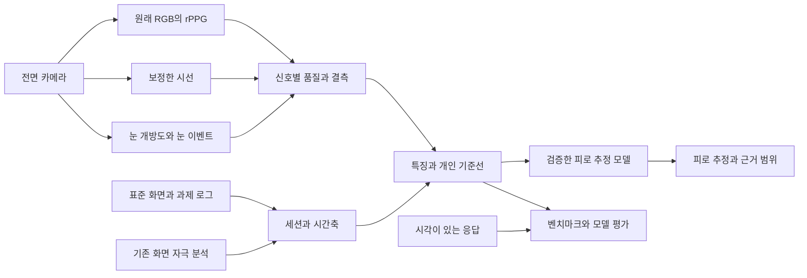

# EyeCare 화면 자극과 생체 신호를 결합한 눈 피로 측정 설계

작성일 2026-10-10 · 설계 기준 Android 0.2.1-alpha · 상태 설계 및 검증 계획

**현재 화면 자극 분석을 유지하고, 전면 카메라의 시선·깜빡임·눈꺼풀 감김·얼굴 rPPG를 같은 시간축에 연결해 눈 피로도를 추정한다.** 첫 구현 경로는 표준 화면을 보는 전후 검사이며, 다른 앱 시청 중 동시 측정은 별도 기술 검증을 거쳐 확장한다. 이번 단계의 산출물은 설계·벤치마크·구현 계획이다.

이 계획이 후속 알고리즘 개발의 기준이다. 기존 사업 전략의 카메라·rPPG 보류 순서는 사용자의 이번 지시에 따라 변경한다. 기존 앱에서 구현한 화면 측정·저장·응답·내보내기는 개발 골격으로 사용한다.

관련 문서: [참조 자산과 연구 검토](docs/eye-fatigue/REFERENCE_AUDIT.md), [자체 벤치마크 프로토콜](docs/eye-fatigue/BENCHMARK_PROTOCOL.md), [단계별 구현과 완료 기준](docs/eye-fatigue/IMPLEMENTATION_PLAN.md).

## 1 목표와 측정의 정의

목표는 **화면 사용 후 현재 느끼는 눈의 피로 정도와 개인 기준 대비 변화**를 추정하는 것이다. 화면 자극은 원인 후보의 입력이고, 카메라에서 측정한 눈·맥박 특징은 반응의 입력이다. 피로는 여러 특징과 실제 응답의 관계를 학습한 추정 결과다.

| 결과 | 의미 | 정답 또는 비교 기준 |
|---|---|---|
| 화면 자극 기록 | 실제 분석된 디지털 화면 변화·시간 | 알려진 렌더링 입력·기존 화면 엔진 회귀 |
| 눈 행동 측정 | 깜빡임·눈 개방도·폐쇄 시간·검사 중 시선 | 영상 수동 라벨, 알려진 목표 위치, 가능하면 기준 시선 장비 |
| rPPG 측정 | 얼굴 색 변화에서 얻은 맥박 특징 | 동기화한 접촉 PPG 또는 ECG |
| 눈 피로 추정 | 그 시점의 눈 피로 자가보고를 예측한 값 | 고정 질문·시각의 자가보고, 반복성·독립 참가자 평가 |
| 사용 전후 변화 | 같은 검사 조건에서 얻은 추정의 차이 | 짝을 이룬 검사와 응답, 무부하 반복 대조 |

초기 학습 목표는 `지금 눈이 얼마나 피곤한가요?`의 **0~10 NRS**다. 건조·따가움, 졸림, 전반적 피곤함은 별도 응답으로 수집한다. 기존 0~4 불편감은 그대로 보존하고 새 질문과 구별한다. 서로 다른 척도를 임의 환산해 정답을 섞지 않는다.

검증된 모델의 첫 출력 후보는 `눈 피로 추정 0~10`, `이전 검사 대비 변화`, `사용한 신호`, `측정 품질`이다. 학습·독립 평가 전에는 관측 특징과 개인 비교만 보여주고 피로 점수를 생성하지 않는다. 사용자에게 보여줄 점수의 의미는 ‘현재 눈 피로 응답에 대응하도록 검증한 추정값’으로 고정한다. 원인·질병·치료 효과까지 확대하지 않는다.

## 2 측정 방식의 조합

| 방식 | 화면 | 눈·rPPG | 장점 | 기술 과제와 적용 순서 |
|---|---|---|---|---|
| **A 표준 검사와 기존 분석 연결** | 기존 앱으로 콘텐츠 사용 구간 분석 | 사용 전·후 동일한 표준 화면에서 전면 카메라 측정 | 밝기·자세·과제를 맞추기 쉽고 기준 라벨 구축 가능 | **첫 구현 방식**. 검사 지연·검사 자체의 영향 기록 |
| **B 앱 안에서 동시 연구 측정** | EyeCare의 알려진 참조 콘텐츠 | 같은 폰 전면 카메라로 동시 측정 | 자극–반응 동기화와 원인 분석에 유리 | 참조 렌더러·카메라·화면 특징을 병행하는 연구 모드 |
| **C 다른 앱 사용 중 동시 측정** | 기존 MediaProjection | 사용자가 명시적으로 시작한 camera 전경 서비스 | 실제 쇼츠·게임 사용 중 눈 반응을 연결 | 동시 자원·백그라운드 전환·카메라 경쟁·전력·정책 게이트 통과 후 |
| **D PC 웹캠 연구** | 같은 과제의 PC 버전 또는 별도 폰 화면 | PC 웹캠과 기준 장비 | 기존 뉴로렌즈 재사용과 연구 반복에 유리 | 연구 벤치마크용. 카메라가 아래를 보는 눈을 가리면 관측 불가 처리 |

A는 검사 시점의 눈 상태를 측정한다. 검사 결과를 앞선 콘텐츠 구간 전체의 실제 시선이나 폐쇄 시간으로 채우지 않는다. B·C는 동시 관측이 확보된 부분에서만 시간상 연결을 계산한다. D의 성공을 모바일 성공으로 간주하지 않는다.

Android는 보이는 앱에서 적절하게 시작한 camera 전경 서비스의 백그라운드 카메라 접근 경로를 제공한다. 따라서 C는 확인할 수 있는 기술 후보다. 사용자 시작 없이 백그라운드에서 자동으로 켜는 설계는 사용하지 않는다. [전경 서비스 공식 문서](https://developer.android.com/develop/background-work/services/fgs/service-types#camera)

## 3 표준 검사 화면

### 반복 검사의 초안

반복 검사는 **약 100초**로 설계하고 첫 검사에는 보정·검증 약 60초를 추가한다. 시간은 연구용 초기 설계이며 사용성·측정 정확도 결과로 변경한다. 짧은 검사에서 얻는 사건 수와 신호 길이에 맞춰 출력 범위를 정한다.

| 단계 | 길이 | 화면과 지시 | 얻는 데이터 |
|---|---:|---|---|
| 위치·품질 확인 | 10초 | 얼굴 위치·거리 안내, 안정화 | 해상도·조명·자세·카메라 FPS·색 변화 품질 |
| 자연 보기 | 60초 | 평균 색·밝기가 일정한 중립 화면. 자연스럽게 보기 | 자연 깜빡임, 눈 개방도, 폐쇄 시간, rPPG HR |
| 고정 응시 | 15초 | 서로 떨어진 3개 목표를 5초씩 보기 | 기존 보정 검증, 시선 분산·구역 정확도 |
| 부드러운 추적 | 15초 | 일정 평균 밝기의 작은 목표를 천천히 따라보기 | 추적 오차·위상 지연 후보 |

처음에는 9개 보정 위치와 보정에 쓰지 않은 검증 위치를 제공한다. 재검사는 3개 검사 목표를 검증에만 쓰고, 보정이 실패하거나 자세·방향이 바뀌면 별도 재보정한다. 자동 보정으로 실패를 숨기지 않는다.

검사 화면은 급격한 밝기·색 변화와 점멸을 사용하지 않는다. 콘텐츠 자극을 재현하는 연구 과제는 별도이며 일상적인 영상·읽기 범위에서 설계한다. CFF를 휴대폰 화면으로 구현해 자체 피로 정답으로 사용하는 과제는 현재 범위에 없다.

화면 밝기는 참가자가 확인한 일정 값으로 유지하며 자동 밝기·주변 조도·가로세로 방향·카메라 위치·거리·안경을 기록한다. 화면 픽셀값과 밝기 슬라이더는 실제 광량의 대용 기록이다. 실측 조도계가 있는 연구에서는 실제 조도도 함께 기록한다.

초기 기준 조건은 폰을 거치하고 35~45cm에서 세로로 보는 방식으로 시험한다. PC 비교는 약 50~65cm부터 시작한다. 이 거리는 기준 조건 후보이며 사용 권고나 측정 성공 보장이 아니다. 손에 든 폰·하방 시선·낮은 조도는 별도의 강건성 조건으로 추가한다.

### 전후 검사와 상태 연결

`현재 응답 → 표준 검사 PRE → 기존 콘텐츠 분석 → 종료 직후 응답 → 표준 검사 POST → 선택 휴식 → 응답 및 RECOVERY 검사`

POST 응답은 검사 전에 받아 검사 자체의 휴식이 초기 응답을 바꾸지 않도록 한다. 검사 시작·끝과 노출 종료의 간격을 모두 저장한다. PRE·POST 검사 순서·화면·밝기를 맞춘다. RECOVERY는 휴식 후 별도 측정이며 POST를 덮어쓰지 않는다.

PRE는 ‘무조건 피로 0’이 아니다. 당시 상태와 반복 기준선의 하나다. 검사 중 일부 단계가 실패해도 다른 단계의 실제 관측 결과는 남긴다.

## 4 시스템 구조

현재 `ExposureEngine`의 임계값과 결과는 그대로 보존한다. 카메라 표본율을 화면 엔진의 표본율과 독립적으로 정한다. 새 엔진은 기존 기록 ID와 검사 ID를 연결해 읽는다.

| 새 모듈 | 역할 | 기존 연결 |
|---|---|---|
| `AssessmentCoordinator` | PRE·EXPOSURE·POST·RECOVERY 순서, 중단·복귀·연결 | 기존 세션 시작·종료와 연결 |
| `ReferenceTaskPlayer` | 화면 과제·실제 표시 시각·목표 좌표·버전 | 자체 벤치마크의 과제 정답 |
| `FrontCameraSource` | CameraX/Camera2, 프레임 시각·회전·색 형식·카운터 | 기존 ProjectionService와 독립 |
| `FaceEyeExtractor` | MediaPipe, 좌우 눈·홍채·머리 자세·ROI | 고정 뉴로렌즈 특징 수학 이전 |
| `EyeEventEngine` | 깜빡임·부분 깜빡임 후보·긴 감김·폐쇄 시간 | 새 순수 Kotlin 엔진 |
| `GazeEngine` | 개인 보정·검증·고정 응시·추적 특징 | 기존 수학·품질 검증 재사용 |
| `PulseEngine` | POS·CHROM, ROI별 후보·실측 시각·광학 잡음 | 기존 rPPG 수학·검증 재사용 |
| `SignalQualityGate` | 각 특징의 채택·결측·이유 | 현재 품질 개념 확장 |
| `FeatureAssembler` | 관측 범위·검사 역할·과제·개인 기준선 정렬 | 화면 10초 창과 검사 요약 연결 |
| `FatigueEstimator` | 검증한 입력 조합별 모델과 추정 구간 | 모델 레지스트리와 결과 저장 |
| `AssessmentRepository` | 검사·응답·버전·관측 특징·모델 기록 | SessionStore·내보내기·집계 확장 |

MediaPipe는 랜드마크와 표정 계수를 제공하므로 시선·피로 계산을 별도로 구현한다. [Android Face Landmarker](https://ai.google.dev/edge/mediapipe/solutions/vision/face_landmarker/android)

## 5 눈과 시선 특징

### 눈 개방도와 깜빡임

양 눈을 각각 계산한다. 기본 형상은 눈 가로 길이로 정규화한 눈꺼풀 간격이다. 초기 정상 보기에서의 열림값과 머리 자세·하방 시선 영향을 보정하되, 실제 점진적 감김을 정상화해 없애지 않도록 보정 모델을 고정한다.

`normalizedOpen = 관측 눈꺼풀 간격 / 같은 조건의 기준 눈꺼풀 간격`

`closureRatio80 = normalizedOpen ≤ 0.20인 관측 시간 / 유효 눈 관측 시간`

이는 개인 기준 대비 80% 이상 닫힌 **형상 대용 특징**이다. 실제 동공이 80% 가려졌다는 측정과 동일하지 않으며, 졸림용 PERCLOS와 명칭·판정 규칙을 구별한다. 눈 개방도 절반 이하 비율·긴 감김 시간·좌우 차이를 각각 보존한다.

이벤트 엔진은 `열림 → 감기는 중 → 닫힘/최소 열림 → 다시 열림` 상태를 사용한다. 개인화한 진입·이탈 경계와 히스테리시스를 적용하고, 관측이 끊기면 이벤트를 미완결로 표시한다. 깜빡임 빈도는 확인된 이벤트 수를 실제 유효 관측 시간으로 나눠 계산한다. 반복 표본이나 임의 보간으로 이벤트를 만들지 않는다.

| 특징 | 초기 채택 | 중요 조건 |
|---|---|---|
| 깜빡임 횟수·빈도 | 예 | 실제 표본율·유효 시간·이벤트 수와 함께 보고 |
| 지속시간 중앙값·분포 | 조건부 | 시작·끝이 관측된 이벤트만, 프레임 간격에 따른 시간 불확실성 표시 |
| 깜빡임 간격 | 조건부 | 중간 누락이 있는 간격을 긴 무깜빡임으로 세지 않음 |
| 긴 눈 감김·개방도 저하 | 예 | 의도적 눈감기·하방 시선·졸림을 따로 라벨링 |
| 불완전 깜빡임 비율 | 후보 | 단순 EAR로 완전 접촉을 확정하지 않음. 원본 눈 ROI와 수동 라벨 비교 통과 후 사용 |
| 감김·열림 속도 | 연구 후보 | 고율 영상 기준으로 정확도 확인 전 피로 모델에서 제외 |

**검출 품질은 눈 열림과 독립적이어야 한다.** 얼굴 존재·ROI 해상도·가림·반사·추적 불연속·영상 밝기로 품질을 평가한다. 눈이 닫혀도 눈꺼풀 윤곽을 관측할 수 있으면 폐쇄 시간에 포함한다. 눈이 가려져 관측할 수 없으면 결측이다.

### 시선

기존 홍채 좌표·머리 자세·정규화된 얼굴 위치를 사용해 보정한다. 보정 모델은 세션 중 고정하고 검증 위치는 학습에 쓰지 않는다. 목표 좌표는 보정 학습과 오차 계산에만 쓰며 측정 시선을 목표 쪽으로 끌어당기지 않는다.

초기 특징은 구역 분류, 고정 응시의 분산·이탈, 부드러운 추적의 오차·위상이다. 자유 콘텐츠에서는 ‘화면 안/밖’도 오차와 자세 검증을 통과한 범위에만 적용한다. 30fps와 일반 RGB 카메라로 미세 사카드·정확한 최고 속도를 핵심 지표로 삼지 않는다.

전후의 눈 움직임 변화는 동일 과제·방향·거리·보정 품질에서 비교한다. 손으로 든 폰의 움직임과 머리 움직임을 눈 반응과 구별한다. 실제 주시점을 확인할 기준 장비가 없으면 목표 위치와의 오차는 **목표 대용 오차**로 명시한다.

## 6 rPPG와 화면 잡음

### 첫 rPPG 경로

전면 카메라에서 이마와 양 볼의 원래 RGB 평균을 독립적으로 추출한다. 랜드마크용 밝기 보정·미화·합성 보정 영상은 맥박 입력으로 사용하지 않는다. 가능한 카메라의 AE/AWB 상태, 노출·게인·표본 시각을 기록한다.

POS와 CHROM을 기준 방법으로 이전하고 주파수·시간 영역의 합의, ROI 간 합의, 잡음·실제 유효 시간을 평가한다. 짧은 빈 구간의 재표본화는 방법·허용 길이를 고정해 비교하되, 실제 관측과 보간을 구별한다. 긴 누락을 이어 붙이거나 누락을 다른 ROI의 실제 값처럼 채우지 않는다.

표준 자연 보기 60초에서 HR 중앙값·변동과 PRE–POST 변화 후보를 만든다. HR 상승을 눈 피로로 바로 환산하지 않는다. 정신적 각성·졸림·호흡·움직임·카페인·운동 등 맥락을 통제 또는 기록하고 추가 기여도를 평가한다.

**짧은 검사에서는 HRV를 기본 출력하지 않는다.** 맥박 주파수가 맞아도 박동 시각이 정확하다는 뜻은 아니다. HRV 편입은 3~5분 안정 구간과 ECG/박동 시각 기준의 별도 평가를 통과해야 한다. 얼굴 PPG 기반 간격 변동은 PRV로 구별하고 HRV와의 일치 여부를 확인한다.

### 화면 자극이 카메라를 오염시키는 경우

어두운 방의 화면 색·밝기 변화는 얼굴 RGB를 변화시킬 수 있다. 눈 피로 입력인 화면 변화와 rPPG 잡음이 같은 원인에서 생기는 상황이다. 이를 제어하지 않으면 화면이 번쩍일 때 생긴 광학 잡음을 생체 반응으로 학습할 수 있다.

첫 피로 모델의 rPPG는 일정한 표준 화면 구간에서 채택한다. B·C에서는 ROI별 공통 변화, 비피부 참조 영역의 변화, 카메라 AE/AWB, 알려진 자극 시각을 추가 기록해 오염을 평가한다. 단순 회귀로 화면 성분을 빼면 진짜 맥박도 제거할 수 있으므로 접촉 기준과 전후 오차를 비교한다.

기존 화면 엔진의 2fps 결과로 맥박 대역의 광학 간섭을 모두 판정할 수 없다. 참조 과제는 고율의 실제 표시 이벤트 로그를 따로 보관하고, 카메라 RGB는 충분한 표본율로 처리한다. 실제 콘텐츠의 강한 오염 구간은 rPPG를 보류하면서 눈·화면의 유효 관측을 남긴다.

## 7 시간 정렬과 신호별 품질

세션 기준 시계는 `elapsedRealtimeNanos`로 둔다. 각 입력은 센서 시각, 수신 시각, 변환된 세션 시각을 구별한다. Camera2 시간 소스를 확인하고, 다른 시계면 offset·drift·불확실성을 추정한다. `ImageReader`의 수신 시각만으로 실제 표시·노출 시각이 정확히 같다고 가정하지 않는다. [Camera2 타임스탬프](https://developer.android.com/reference/android/hardware/camera2/CameraCharacteristics#SENSOR_INFO_TIMESTAMP_SOURCE)

PC·외부 센서는 독립 시계와 동기화 오차를 저장한다. HR만 주는 BLE 알림은 파형·박동 시각 기준이 아니다. 표준 화면의 목표 이동은 예약 시각과 실제 표시 시각을 구별한다. 단순 동시 시작 버튼만으로 시간 정렬을 승인하지 않는다.

| 입력 | 초기 공학 조건 후보 | 부족할 때 처리 |
|---|---|---|
| 눈 이벤트 | 목표 30fps, 실제 눈 특징 중앙 간격 ≤50ms, p95 ≤100ms, 자연 보기 60초의 유효율 ≥80% | 빈도·기간 특징 보류, 관측 범위와 실패 사유 표시 |
| 눈 ROI | 원본 영상 눈 가로폭 40px 이상부터 시험, 안경 반사·가림·고개 각도 층화 | 불완전 깜빡임 등 정밀 특징에 더 엄격한 기준 적용 |
| 시선 | 보정 검증 중앙 오차 ≤화면 긴 변의 8%, p95 ≤15%, 구역 분류 성능 별도 | 피로 모델의 시선 특징 제외 |
| rPPG | 60초 구간의 실제 유효 시간 ≥45초, 검증한 ROI·표본율·광학 조건 충족 | rPPG 부분 결측, 화면·눈 결과 보존 |
| 화면 | 기존 유효 시간·제외 시간과 버전 보존, 모델이 학습한 커버리지 범위에서만 적용 | 저품질 화면 특징 제외, 관측하지 않은 시간 확대 추정 금지 |
| 동시 연결 | 센서·표시 정렬 불확실성 확인, HR 창 비교 ≤100ms부터 시험 | 빠른 사건 지연 분석 보류, 느린 요약만 조건부 사용 |

위 숫자는 잠정 검증 조건이며 달성 성능·의학적 경계가 아니다. 독립 검증 전 개발 자료로 조정하고 버전을 올린다. ‘품질 0.8’을 ‘피로가 맞을 확률 80%’로 표시하지 않는다.

피로 모델 입력마다 `value`, `unit`, `observedMs`, `eligibleMs`, `qualityReasons`, `source`, `algorithmVersion`을 둔다. 검출 실패·카메라 거절·눈 감김·블링크 중 시선 불가를 서로 다른 상태로 저장한다.

## 8 피로 모델 설계

### 특징과 기준선

화면 입력은 유효 시간·평균 변화·큰 변화 구간·변화 면적·누락이다. 눈 입력은 개방도 분포·깜빡임 빈도/기간/간격·감김 시간이며, 시선은 같은 표준 과제의 오차·분산·추적 특징이다. rPPG는 검증한 안정 구간 HR와 변화부터 사용한다.

개인 기준선은 최소 3회 품질이 충분한 같은 조건의 검사에서 중앙값과 변동을 구한다. 초기에는 집단 모델과 당시 PRE를 사용하고 개인 자료 수·조건을 명시한다. 기준선 날짜·응답·기기·안경·조명·자세가 다르면 별도 층으로 둔다. 기준선 갱신 규칙을 고정해 계속 나빠지는 상태를 정상으로 흡수하지 않는다.

### 단계별 후보

1. **관측 모델:** 화면·눈·HR 수치와 품질을 반환한다. 임의 피로 가중치 없음.
2. **설명 가능한 기준 모델:** 사전 선택한 소수 특징의 규제 회귀 또는 순서형 모델. 수가 적은 표본에 복잡한 모델을 우선 사용하지 않는다.
3. **비교 모델:** 충분한 참가자 자료에서 얕은 트리/부스팅과 비교. 특징 선택·결측 처리·보정은 훈련/검증 자료 안에서 수행한다.
4. **개인화:** 새로운 사람에 대한 평가와 개인 과거 기록을 쓰는 미래 시점 평가를 구별한다. 두 평가를 통과한 범위에서 기준선·추천을 개인화한다.

고정 0~100 임의 가중합을 완성된 측정 알고리즘으로 사용하지 않는다. 초기 0~10 모델을 평가한 뒤 점수 표현을 결정한다. 깜빡임·HR 등 특징의 증가/감소 방향을 눈 피로에 일률적으로 고정하지 않는다.

첫 수학적 기준은 `예측 NRS = clip(β0 + Σ βj × zj + 사전 정의한 맥락 항, 0, 10)`인 규제 회귀다. `zj`는 훈련 자료로 고정한 정규화 특징 또는 유효 개인 PRE 대비 변화이며, 계수 β는 실제 응답에서 학습한다. 목표 정의와 변환은 모델 버전에 고정한다. 예측 구간은 참가자를 분리한 검증 자료에서 보정하고, 충분한 검증 전에는 확률이나 정밀한 신뢰구간을 표시하지 않는다.

### 추가 기여 비교

공통된 과거 응답·사용 맥락은 모든 모델에 동일하게 제공하고, 예측하려는 현재 응답은 입력에서 제외한다.

| 모델 | 입력 |
|---|---|
| M0 | 경과 시간·사용 맥락·과거/PRE 응답 |
| M1 | M0 + 품질이 확인된 화면 특징 |
| M2 | M1 + 눈 개방도·깜빡임·감김 |
| M3 | M2 + 검증한 시선 특징 |
| M4 | M3 + 검증한 rPPG 특징 |

전체 모델 M4와 각 신호를 제거한 비교를 모두 수행한다. 같은 참가자·같은 관측 부분으로 공정하게 비교한 결과와, 실제 결측을 포함한 전체 이용자 결과를 함께 보고한다. rPPG가 유효한 사람만 남겨 성능을 계산하면 선택 편향을 숨길 수 있다.

모든 신호가 있는 모델, 눈 중심 모델, 시선/rPPG가 없는 모델은 **별도로 훈련·검증한 입력 조합**으로 제공한다. 입력이 빠질 때 가중치를 임의 재분배하지 않는다. 검증된 조합이 없으면 피로 추정을 보류하고 관측 결과만 제공한다.

## 9 데이터와 기존 앱 호환

새 `AssessmentRun`이 기존 `Session.id`들을 참조한다. 기존 SQLite 기록의 의미와 원본 보고서를 보존하고, 새 테이블·내보내기 스키마를 추가한다. 과거 화면 기록에 존재하지 않았던 카메라 측정값을 채우지 않는다.

| 새 기록 | 필수 항목 |
|---|---|
| AssessmentRun | runId, exposureSessionIds, participant pseudonym(동의 연구만), 상태, PRE/POST/RECOVERY 연결 |
| CheckRecord | checkId, role, 실제 단계 시각, referenceVersion, device/geometry, 카메라 설정, 품질 |
| Eye/Gaze/PulseFeature | 특징·단위·유효 범위·결측 사유·알고리즘/보정 버전 |
| Response | 질문·척도 버전, 응답 값/건너뛰기, wall/monotonic 시각, 단계 |
| Prediction | 목표 정의·modelId/hash, 실제 사용 입력 조합, 값/구간, 보류 이유 |
| Consent/ResearchLink | 연구 목적, 수집 항목·원본 영상 여부, 철회와 삭제 범위 |

제품 기본 저장은 수치 특징과 요약이다. 원본 얼굴·눈 영상은 검출 벤치마크 참가자의 별도 동의로만 보관하며 일반 제품 내보내기와 분리한다. 영상 없는 특징만으로 새 검출기의 정확도를 재검증할 수 없으므로, 연구 원본의 목적·접근·보관 기간을 사전에 정한다.

집계기는 기존 스키마 1·2와 새 스키마 3을 읽는 방향으로 확장한다. 새 피로 자료는 `runId/checkId/role/questionVersion`으로 묶고, 기존 세션 중복 제거 규칙과 수정본 충돌 검사를 유지한다. 내보내기·전송·삭제의 검증 범위를 카메라 자료까지 확장한다.

## 10 구현 전 확정할 품질 조건

상세 조건은 [벤치마크](docs/eye-fatigue/BENCHMARK_PROTOCOL.md)에 둔다. 구현 순서는 [실행 계획](docs/eye-fatigue/IMPLEMENTATION_PLAN.md)을 따른다.

- 화면 분석 결과가 새 카메라 경로를 끈 상태에서 기존과 동일해야 한다.
- 눈이 닫힌 사실과 검출 실패를 구별하는 수동 라벨·회귀 검사가 있어야 한다.
- HR와 피로의 정확도를 별도로 평가하고 HR 성공으로 HRV를 승인하지 않아야 한다.
- PRE/POST 검사 차이와 같은 조건의 무부하 반복 변동을 비교해야 한다.
- 현재 응답·같은 참가자·겹치는 창·미래 데이터가 독립 평가에 새지 않아야 한다.
- 실제 추정 성능과 보류율·기기별 실패율·전력·발열을 함께 보고해야 한다.

첫 내부 앱의 완료 목표는 **기존 화면 분석 + 표준 검사에서의 눈·시선·rPPG 관측 + 연결된 보고서**다. 피로 점수 적용은 자체 벤치마크와 잠금 평가를 통과한 모델부터 진행한다. 시행착오를 줄이기 위해 알려진 오차와 실패 조건을 먼저 계약·라벨·통과 기준으로 만든다.
